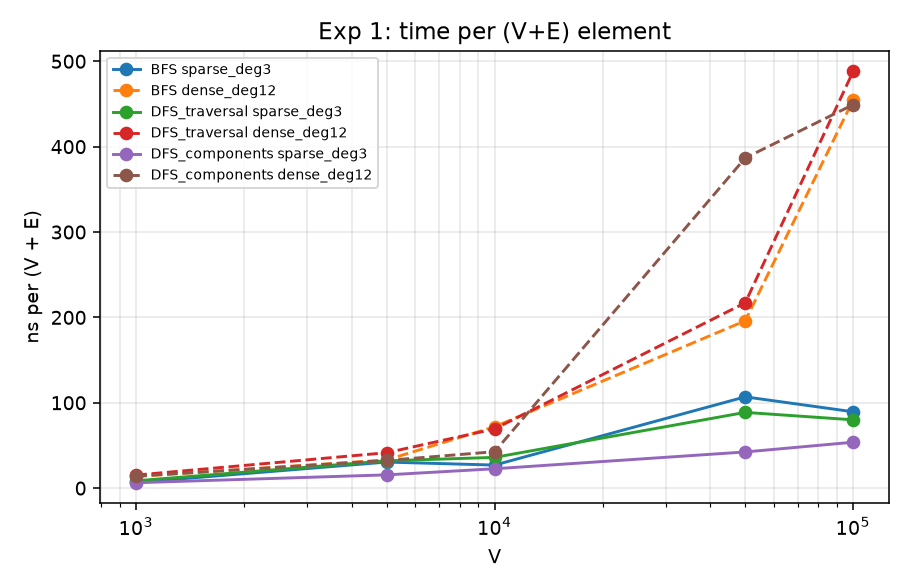
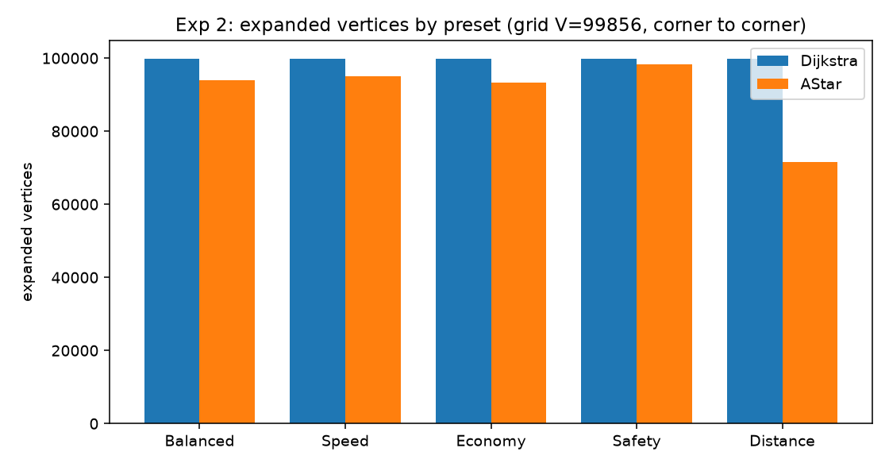
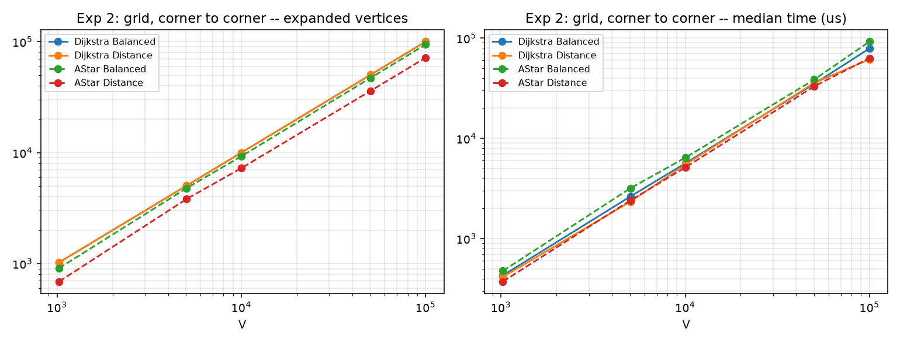
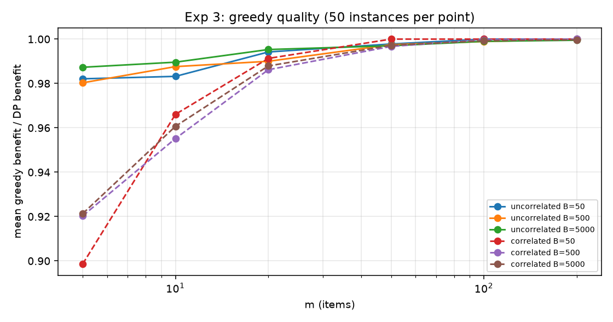
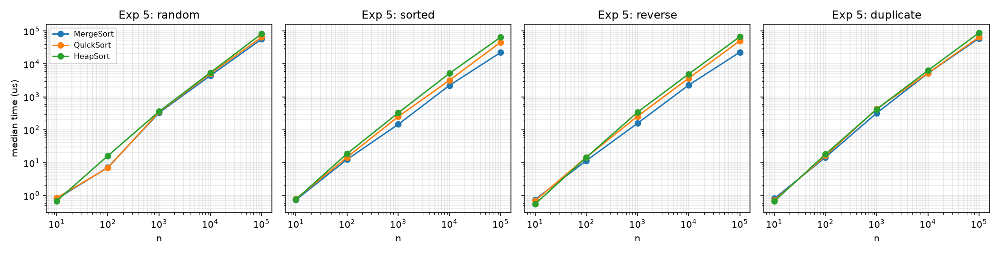

# Experiment results

Generated by `tools/plot_results.py` from `results/summary/*.csv` (raw samples in `results/raw/`). Times are medians of the timed runs, in microseconds.

## Hardware

```
Machine used for the reported results (recorded by hand; smartrace_bench
cannot query the CPU without Windows-specific headers):
cpu: 12th Gen Intel(R) Core(TM) i7-1265U (10 cores / 12 threads, base 1800 MHz, turbo boost on)
ram: 31.4 GB
os: Microsoft Windows 11 Pro build 26300
power plan: Balanced (laptop on mains power)
compiler: MSVC 19.51 (Visual Studio 2026), x64, Release (/O2), CMake
benchmark: single-threaded; all experiments in one process, one after another
```

## Environment

```
compiler: MSVC 195136248
build: Release (optimised)
pointer size: 64 bits
runs per configuration: 7 (after 2 warm-up runs)
input seed: 42
quick mode: no
timer: QueryPerformanceCounter, microseconds
```

## Experiment 1 -- BFS and DFS

| algo | density | V | E | median us | ns/(V+E) | visited | edges examined |
|---|---|---|---|---|---|---|---|
| BFS | sparse_deg3 | 1000 | 1500 | 16.5 | 6.60 | 1000 | 3000 |
| DFS_traversal | sparse_deg3 | 1000 | 1500 | 21.5 | 8.60 | 1000 | 3000 |
| DFS_components | sparse_deg3 | 1000 | 1500 | 15.8 | 6.32 | 1000 | 6000 |
| DFS_cycles | sparse_deg3 | 1000 | 1500 | 2.5 | 0.98 | 56 | 85 |
| BFS | sparse_deg3 | 5000 | 7500 | 381.5 | 30.52 | 5000 | 15000 |
| DFS_traversal | sparse_deg3 | 5000 | 7500 | 399.6 | 31.97 | 5000 | 15000 |
| DFS_components | sparse_deg3 | 5000 | 7500 | 194.2 | 15.53 | 5000 | 30000 |
| DFS_cycles | sparse_deg3 | 5000 | 7500 | 6.1 | 0.49 | 167 | 254 |
| BFS | sparse_deg3 | 10000 | 15000 | 675.2 | 27.01 | 10000 | 30000 |
| DFS_traversal | sparse_deg3 | 10000 | 15000 | 900.4 | 36.02 | 10000 | 30000 |
| DFS_components | sparse_deg3 | 10000 | 15000 | 567.1 | 22.68 | 10000 | 60000 |
| DFS_cycles | sparse_deg3 | 10000 | 15000 | 9.8 | 0.39 | 80 | 124 |
| BFS | sparse_deg3 | 50000 | 75000 | 13364.3 | 106.91 | 50000 | 150000 |
| DFS_traversal | sparse_deg3 | 50000 | 75000 | 11089.7 | 88.72 | 50000 | 150000 |
| DFS_components | sparse_deg3 | 50000 | 75000 | 5295.7 | 42.37 | 50000 | 300000 |
| DFS_cycles | sparse_deg3 | 50000 | 75000 | 297.9 | 2.38 | 442 | 684 |
| BFS | sparse_deg3 | 100000 | 150000 | 22358.9 | 89.44 | 100000 | 300000 |
| DFS_traversal | sparse_deg3 | 100000 | 150000 | 20002.5 | 80.01 | 100000 | 300000 |
| DFS_components | sparse_deg3 | 100000 | 150000 | 13442.4 | 53.77 | 100000 | 600000 |
| DFS_cycles | sparse_deg3 | 100000 | 150000 | 617.8 | 2.47 | 790 | 1211 |
| BFS | dense_deg12 | 1000 | 6000 | 95.8 | 13.69 | 1000 | 12000 |
| DFS_traversal | dense_deg12 | 1000 | 6000 | 106.9 | 15.27 | 1000 | 12000 |
| DFS_components | dense_deg12 | 1000 | 6000 | 97.9 | 13.98 | 1000 | 24000 |
| DFS_cycles | dense_deg12 | 1000 | 6000 | 1.1 | 0.16 | 48 | 75 |
| BFS | dense_deg12 | 5000 | 30000 | 1156.2 | 33.03 | 5000 | 60000 |
| DFS_traversal | dense_deg12 | 5000 | 30000 | 1451.9 | 41.48 | 5000 | 60000 |
| DFS_components | dense_deg12 | 5000 | 30000 | 1135.0 | 32.43 | 5000 | 120000 |
| DFS_cycles | dense_deg12 | 5000 | 30000 | 5.2 | 0.15 | 139 | 211 |
| BFS | dense_deg12 | 10000 | 60000 | 5033.8 | 71.91 | 10000 | 120000 |
| DFS_traversal | dense_deg12 | 10000 | 60000 | 4855.7 | 69.37 | 10000 | 120000 |
| DFS_components | dense_deg12 | 10000 | 60000 | 2986.5 | 42.66 | 10000 | 240000 |
| DFS_cycles | dense_deg12 | 10000 | 60000 | 6.0 | 0.09 | 142 | 212 |
| BFS | dense_deg12 | 50000 | 300000 | 68598.0 | 195.99 | 50000 | 600000 |
| DFS_traversal | dense_deg12 | 50000 | 300000 | 75973.5 | 217.07 | 50000 | 600000 |
| DFS_components | dense_deg12 | 50000 | 300000 | 135352.8 | 386.72 | 50000 | 1200000 |
| DFS_cycles | dense_deg12 | 50000 | 300000 | 95.4 | 0.27 | 163 | 247 |
| BFS | dense_deg12 | 100000 | 600000 | 318244.2 | 454.63 | 100000 | 1200000 |
| DFS_traversal | dense_deg12 | 100000 | 600000 | 341668.7 | 488.10 | 100000 | 1200000 |
| DFS_components | dense_deg12 | 100000 | 600000 | 314409.6 | 449.16 | 100000 | 2400000 |
| DFS_cycles | dense_deg12 | 100000 | 600000 | 1143.4 | 1.63 | 367 | 550 |

## Experiment 2 -- Dijkstra and A*

| graph | query | preset | V | Dijkstra us | A* us | Dijkstra expanded | A* expanded | Dijkstra heap ops | A* heap ops | cost (both) | h scale |
|---|---|---|---|---|---|---|---|---|---|---|---|
| C1_Harbor | Start_to_CP5 | Balanced | 22 | 4.0 | 3.3 | 19 | 7 | 41 | 18 | 3.7577 | 0.00494 |
| C1_Harbor | Start_to_CP5 | Speed | 22 | 3.9 | 2.7 | 19 | 7 | 40 | 18 | 3.9340 | 0.00529 |
| C1_Harbor | Start_to_CP5 | Economy | 22 | 3.9 | 2.7 | 19 | 7 | 41 | 18 | 4.6195 | 0.00600 |
| C1_Harbor | Start_to_CP5 | Safety | 22 | 3.9 | 2.8 | 18 | 8 | 42 | 21 | 2.0850 | 0.00247 |
| C1_Harbor | Start_to_CP5 | Distance | 22 | 3.9 | 2.5 | 19 | 6 | 40 | 15 | 5.0648 | 0.00706 |
| C1_Harbor | CP5_to_CP10 | Balanced | 22 | 4.8 | 4.3 | 21 | 12 | 43 | 31 | 4.2707 | 0.00494 |
| C1_Harbor | CP5_to_CP10 | Speed | 22 | 4.8 | 4.2 | 21 | 10 | 43 | 28 | 4.4360 | 0.00529 |
| C1_Harbor | CP5_to_CP10 | Economy | 22 | 4.8 | 4.2 | 21 | 12 | 43 | 30 | 5.2953 | 0.00600 |
| C1_Harbor | CP5_to_CP10 | Safety | 22 | 5.0 | 4.2 | 22 | 13 | 46 | 31 | 2.4104 | 0.00247 |
| C1_Harbor | CP5_to_CP10 | Distance | 22 | 5.0 | 3.9 | 21 | 9 | 43 | 25 | 5.6616 | 0.00706 |
| C2_TwinPeaks | Start_to_CP5 | Balanced | 26 | 2.8 | 2.5 | 8 | 4 | 20 | 12 | 1.9623 | 0.00605 |
| C2_TwinPeaks | Start_to_CP5 | Speed | 26 | 2.7 | 2.4 | 8 | 4 | 20 | 12 | 2.0846 | 0.00648 |
| C2_TwinPeaks | Start_to_CP5 | Economy | 26 | 2.6 | 2.4 | 8 | 4 | 20 | 12 | 2.3780 | 0.00734 |
| C2_TwinPeaks | Start_to_CP5 | Safety | 26 | 2.5 | 2.4 | 7 | 4 | 18 | 12 | 1.0499 | 0.00302 |
| C2_TwinPeaks | Start_to_CP5 | Distance | 26 | 2.6 | 2.4 | 8 | 4 | 20 | 12 | 2.7239 | 0.00864 |
| C2_TwinPeaks | CP5_to_CP10 | Balanced | 26 | 3.8 | 2.7 | 15 | 6 | 34 | 15 | 2.9751 | 0.00605 |
| C2_TwinPeaks | CP5_to_CP10 | Speed | 26 | 3.8 | 2.9 | 15 | 5 | 33 | 14 | 3.1227 | 0.00648 |
| C2_TwinPeaks | CP5_to_CP10 | Economy | 26 | 3.8 | 2.9 | 15 | 6 | 34 | 15 | 3.6195 | 0.00734 |
| C2_TwinPeaks | CP5_to_CP10 | Safety | 26 | 3.5 | 2.4 | 16 | 6 | 36 | 15 | 1.6938 | 0.00302 |
| C2_TwinPeaks | CP5_to_CP10 | Distance | 26 | 4.0 | 2.9 | 15 | 5 | 33 | 14 | 3.9912 | 0.00864 |
| C3_Downtown | Start_to_CP5 | Balanced | 21 | 4.6 | 3.7 | 17 | 8 | 37 | 24 | 3.4192 | 0.00530 |
| C3_Downtown | Start_to_CP5 | Speed | 21 | 4.4 | 3.6 | 18 | 8 | 39 | 24 | 3.5231 | 0.00568 |
| C3_Downtown | Start_to_CP5 | Economy | 21 | 4.3 | 3.7 | 17 | 8 | 39 | 24 | 4.1859 | 0.00644 |
| C3_Downtown | Start_to_CP5 | Safety | 21 | 4.7 | 4.2 | 17 | 10 | 39 | 27 | 2.0157 | 0.00265 |
| C3_Downtown | Start_to_CP5 | Distance | 21 | 4.2 | 3.7 | 16 | 8 | 34 | 24 | 4.3476 | 0.00758 |
| C3_Downtown | CP5_to_CP10 | Balanced | 21 | 5.4 | 4.9 | 21 | 12 | 42 | 34 | 4.0515 | 0.00530 |
| C3_Downtown | CP5_to_CP10 | Speed | 21 | 5.3 | 5.0 | 21 | 12 | 42 | 34 | 4.2194 | 0.00568 |
| C3_Downtown | CP5_to_CP10 | Economy | 21 | 5.2 | 5.0 | 21 | 12 | 44 | 36 | 4.9564 | 0.00644 |
| C3_Downtown | CP5_to_CP10 | Safety | 21 | 5.6 | 5.5 | 21 | 16 | 46 | 39 | 2.3604 | 0.00265 |
| C3_Downtown | CP5_to_CP10 | Distance | 21 | 4.9 | 4.8 | 21 | 12 | 42 | 34 | 5.3326 | 0.00758 |
| grid_1024 | far_corner_to_corner | Balanced | 1024 | 430.5 | 476.7 | 1024 | 910 | 2496 | 2416 | 34.0301 | 0.00478 |
| grid_1024 | far_corner_to_corner | Speed | 1024 | 439.0 | 517.8 | 1024 | 942 | 2514 | 2526 | 33.3690 | 0.00448 |
| grid_1024 | far_corner_to_corner | Economy | 1024 | 448.0 | 474.9 | 1024 | 896 | 2506 | 2367 | 41.9153 | 0.00602 |
| grid_1024 | far_corner_to_corner | Safety | 1024 | 446.1 | 529.2 | 1024 | 985 | 2550 | 2598 | 20.3803 | 0.00231 |
| grid_1024 | far_corner_to_corner | Distance | 1024 | 415.5 | 373.4 | 1024 | 689 | 2438 | 1848 | 45.5094 | 0.00831 |
| grid_1024 | near_centre_10pct | Balanced | 1024 | 22.8 | 8.6 | 62 | 17 | 178 | 54 | 3.6903 | 0.00478 |
| grid_1024 | near_centre_10pct | Speed | 1024 | 23.4 | 9.5 | 55 | 17 | 154 | 54 | 3.5977 | 0.00448 |
| grid_1024 | near_centre_10pct | Economy | 1024 | 22.7 | 8.6 | 62 | 17 | 175 | 54 | 4.5182 | 0.00602 |
| grid_1024 | near_centre_10pct | Safety | 1024 | 20.9 | 9.4 | 52 | 19 | 151 | 61 | 2.2267 | 0.00231 |
| grid_1024 | near_centre_10pct | Distance | 1024 | 29.7 | 6.8 | 67 | 11 | 185 | 38 | 4.8742 | 0.00831 |
| grid_5041 | far_corner_to_corner | Balanced | 5041 | 2633.2 | 3183.2 | 5041 | 4784 | 12628 | 12894 | 78.9940 | 0.00475 |
| grid_5041 | far_corner_to_corner | Speed | 5041 | 2185.3 | 1819.6 | 5041 | 4764 | 12800 | 12915 | 76.0522 | 0.00443 |
| grid_5041 | far_corner_to_corner | Economy | 5041 | 1986.7 | 2562.5 | 5041 | 4776 | 12656 | 12886 | 97.8052 | 0.00599 |
| grid_5041 | far_corner_to_corner | Safety | 5041 | 2493.1 | 2863.5 | 5041 | 4857 | 13003 | 13142 | 45.6389 | 0.00230 |
| grid_5041 | far_corner_to_corner | Distance | 5041 | 2341.2 | 2405.4 | 5041 | 3820 | 12188 | 10464 | 106.1353 | 0.00832 |
| grid_5041 | near_centre_10pct | Balanced | 5041 | 159.5 | 46.3 | 345 | 88 | 923 | 258 | 8.4943 | 0.00475 |
| grid_5041 | near_centre_10pct | Speed | 5041 | 112.9 | 50.2 | 327 | 87 | 865 | 251 | 8.1210 | 0.00443 |
| grid_5041 | near_centre_10pct | Economy | 5041 | 133.6 | 47.8 | 354 | 92 | 935 | 264 | 10.5709 | 0.00599 |
| grid_5041 | near_centre_10pct | Safety | 5041 | 146.1 | 54.3 | 317 | 104 | 849 | 298 | 5.0574 | 0.00230 |
| grid_5041 | near_centre_10pct | Distance | 5041 | 79.0 | 16.8 | 330 | 53 | 845 | 148 | 10.8162 | 0.00832 |
| grid_10000 | far_corner_to_corner | Balanced | 10000 | 5627.1 | 6399.4 | 9999 | 9273 | 24902 | 25264 | 107.7942 | 0.00475 |
| grid_10000 | far_corner_to_corner | Speed | 10000 | 6118.2 | 6633.3 | 9999 | 9361 | 25436 | 25643 | 104.0634 | 0.00442 |
| grid_10000 | far_corner_to_corner | Economy | 10000 | 5586.2 | 6358.9 | 9999 | 9210 | 24872 | 24964 | 133.4235 | 0.00599 |
| grid_10000 | far_corner_to_corner | Safety | 10000 | 6256.5 | 7076.4 | 9999 | 9567 | 25556 | 25739 | 62.6280 | 0.00230 |
| grid_10000 | far_corner_to_corner | Distance | 10000 | 5458.2 | 5123.7 | 9999 | 7247 | 23943 | 19717 | 146.9869 | 0.00833 |
| grid_10000 | near_centre_10pct | Balanced | 10000 | 365.6 | 106.9 | 689 | 181 | 1786 | 515 | 12.1615 | 0.00475 |
| grid_10000 | near_centre_10pct | Speed | 10000 | 341.6 | 109.3 | 682 | 187 | 1793 | 534 | 11.8943 | 0.00442 |
| grid_10000 | near_centre_10pct | Economy | 10000 | 362.0 | 103.7 | 692 | 177 | 1783 | 510 | 14.9530 | 0.00599 |
| grid_10000 | near_centre_10pct | Safety | 10000 | 389.7 | 143.6 | 701 | 242 | 1884 | 687 | 7.6314 | 0.00230 |
| grid_10000 | near_centre_10pct | Distance | 10000 | 347.3 | 75.1 | 694 | 119 | 1736 | 356 | 15.8240 | 0.00833 |
| grid_50176 | far_corner_to_corner | Balanced | 50176 | 34917.3 | 38582.8 | 50176 | 47043 | 125321 | 126410 | 241.4089 | 0.00476 |
| grid_50176 | far_corner_to_corner | Speed | 50176 | 39008.6 | 42426.6 | 50176 | 47519 | 127759 | 128845 | 232.7205 | 0.00443 |
| grid_50176 | far_corner_to_corner | Economy | 50176 | 34227.0 | 38422.7 | 50176 | 46708 | 125483 | 125642 | 299.1413 | 0.00600 |
| grid_50176 | far_corner_to_corner | Safety | 50176 | 36569.3 | 41948.4 | 50176 | 49317 | 128762 | 131878 | 140.8520 | 0.00230 |
| grid_50176 | far_corner_to_corner | Distance | 50176 | 35741.5 | 33004.0 | 50176 | 35950 | 120457 | 98164 | 329.3506 | 0.00833 |
| grid_50176 | near_centre_10pct | Balanced | 50176 | 2481.0 | 676.9 | 3108 | 783 | 7942 | 2211 | 24.9034 | 0.00476 |
| grid_50176 | near_centre_10pct | Speed | 50176 | 2275.9 | 641.0 | 3098 | 834 | 8028 | 2389 | 24.3274 | 0.00443 |
| grid_50176 | near_centre_10pct | Economy | 50176 | 2424.2 | 662.9 | 3090 | 749 | 7846 | 2089 | 30.5226 | 0.00600 |
| grid_50176 | near_centre_10pct | Safety | 50176 | 2282.2 | 1044.7 | 2983 | 985 | 7799 | 2731 | 14.7299 | 0.00230 |
| grid_50176 | near_centre_10pct | Distance | 50176 | 2363.2 | 687.0 | 3316 | 538 | 8131 | 1564 | 33.9951 | 0.00833 |
| grid_99856 | far_corner_to_corner | Balanced | 99856 | 78525.9 | 91864.9 | 99856 | 93995 | 249178 | 252574 | 341.0630 | 0.00476 |
| grid_99856 | far_corner_to_corner | Speed | 99856 | 78859.4 | 95060.2 | 99856 | 95024 | 254016 | 257925 | 329.4474 | 0.00443 |
| grid_99856 | far_corner_to_corner | Economy | 99856 | 71778.3 | 80239.2 | 99856 | 93225 | 248938 | 250460 | 421.7950 | 0.00600 |
| grid_99856 | far_corner_to_corner | Safety | 99856 | 77781.8 | 90744.5 | 99856 | 98199 | 255807 | 262911 | 199.5244 | 0.00230 |
| grid_99856 | far_corner_to_corner | Distance | 99856 | 61208.0 | 62907.8 | 99856 | 71522 | 239434 | 195826 | 464.6392 | 0.00833 |
| grid_99856 | near_centre_10pct | Balanced | 99856 | 5693.2 | 2008.0 | 6335 | 1524 | 15924 | 4273 | 35.3744 | 0.00476 |
| grid_99856 | near_centre_10pct | Speed | 99856 | 6387.1 | 2366.8 | 6205 | 1534 | 16033 | 4316 | 33.9803 | 0.00443 |
| grid_99856 | near_centre_10pct | Economy | 99856 | 6103.0 | 2402.9 | 6379 | 1493 | 15988 | 4194 | 43.7839 | 0.00600 |
| grid_99856 | near_centre_10pct | Safety | 99856 | 6030.6 | 2712.8 | 6062 | 1838 | 15812 | 5109 | 20.7493 | 0.00230 |
| grid_99856 | near_centre_10pct | Distance | 99856 | 6112.2 | 1958.3 | 6442 | 957 | 15794 | 2710 | 47.3780 | 0.00833 |

## Experiment 3 -- DP and Greedy

### Named cases

| case | items | budget | DP benefit (items) | greedy benefit (items) | exhaustive | greedy strictly worse |
|---|---|---|---|---|---|---|
| brief_ABC | A(6;30) B(5;24) C(5;24) | 10 | 48 (B C) | 30 (A) | 48 | yes |
| G1_team | costs 4;3;3 benefits 9;6;6 | 6 | 12 (1 2) | 9 (0) | 12 | yes |
| G2_team | costs 5;4;4;2 benefits 11;8;8;1 | 8 | 16 (1 2) | 12 (0 3) | 16 | yes |

### Timings

| algo | distribution | m | B | median us | benefit | selected | DP states |
|---|---|---|---|---|---|---|---|
| DP_table | uncorrelated | 5 | 50 | 2.33 | 76 | 3 | 255 |
| DP_value_only | uncorrelated | 5 | 50 | 0.83 | 76 | -1 | 150 |
| Greedy | uncorrelated | 5 | 50 | 0.97 | 76 | 3 | 0 |
| Exhaustive | uncorrelated | 5 | 50 | 0.94 | 76 | 3 | 32 |
| DP_table | uncorrelated | 5 | 500 | 16.86 | 876 | 3 | 2505 |
| DP_value_only | uncorrelated | 5 | 500 | 7.84 | 876 | -1 | 1694 |
| Greedy | uncorrelated | 5 | 500 | 1.03 | 788 | 3 | 0 |
| Exhaustive | uncorrelated | 5 | 500 | 0.91 | 876 | 3 | 32 |
| DP_table | uncorrelated | 5 | 5000 | 164.84 | 5943 | 3 | 25005 |
| DP_value_only | uncorrelated | 5 | 5000 | 59.76 | 5943 | -1 | 13722 |
| Greedy | uncorrelated | 5 | 5000 | 0.99 | 5943 | 3 | 0 |
| Exhaustive | uncorrelated | 5 | 5000 | 0.89 | 5943 | 3 | 32 |
| DP_table | uncorrelated | 10 | 50 | 4.44 | 80 | 5 | 510 |
| DP_value_only | uncorrelated | 10 | 50 | 2.03 | 80 | -1 | 390 |
| Greedy | uncorrelated | 10 | 50 | 1.79 | 80 | 5 | 0 |
| Exhaustive | uncorrelated | 10 | 50 | 86.54 | 80 | 5 | 1024 |
| DP_table | uncorrelated | 10 | 500 | 31.24 | 658 | 5 | 5010 |
| DP_value_only | uncorrelated | 10 | 500 | 17.07 | 658 | -1 | 3955 |
| Greedy | uncorrelated | 10 | 500 | 1.93 | 655 | 6 | 0 |
| Exhaustive | uncorrelated | 10 | 500 | 87.93 | 658 | 5 | 1024 |
| DP_table | uncorrelated | 10 | 5000 | 368.02 | 8089 | 5 | 50010 |
| DP_value_only | uncorrelated | 10 | 5000 | 162.90 | 8089 | -1 | 39301 |
| Greedy | uncorrelated | 10 | 5000 | 0.98 | 8089 | 5 | 0 |
| Exhaustive | uncorrelated | 10 | 5000 | 84.67 | 8089 | 5 | 1024 |
| DP_table | uncorrelated | 20 | 50 | 3.00 | 72 | 14 | 1020 |
| DP_value_only | uncorrelated | 20 | 50 | 1.73 | 72 | -1 | 925 |
| Greedy | uncorrelated | 20 | 50 | 0.67 | 71 | 14 | 0 |
| Exhaustive | uncorrelated | 20 | 50 | 54290.40 | 72 | 14 | 1048576 |
| DP_table | uncorrelated | 20 | 500 | 12.17 | 869 | 16 | 10020 |
| DP_value_only | uncorrelated | 20 | 500 | 8.55 | 869 | -1 | 9315 |
| Greedy | uncorrelated | 20 | 500 | 1.56 | 856 | 16 | 0 |
| Exhaustive | uncorrelated | 20 | 500 | 70161.40 | 869 | 16 | 1048576 |
| DP_table | uncorrelated | 20 | 5000 | 143.70 | 8528 | 13 | 100020 |
| DP_value_only | uncorrelated | 20 | 5000 | 68.85 | 8528 | -1 | 90656 |
| Greedy | uncorrelated | 20 | 5000 | 0.84 | 8528 | 13 | 0 |
| Exhaustive | uncorrelated | 20 | 5000 | 65145.40 | 8528 | 13 | 1048576 |
| DP_table | uncorrelated | 50 | 50 | 4.27 | 93 | 29 | 2550 |
| DP_value_only | uncorrelated | 50 | 50 | 3.15 | 93 | -1 | 2433 |
| Greedy | uncorrelated | 50 | 50 | 1.90 | 93 | 29 | 0 |
| DP_table | uncorrelated | 50 | 500 | 31.11 | 724 | 28 | 25050 |
| DP_value_only | uncorrelated | 50 | 500 | 23.56 | 724 | -1 | 23999 |
| Greedy | uncorrelated | 50 | 500 | 1.86 | 723 | 28 | 0 |
| DP_table | uncorrelated | 50 | 5000 | 343.80 | 8208 | 30 | 250050 |
| DP_value_only | uncorrelated | 50 | 5000 | 192.50 | 8208 | -1 | 239378 |
| Greedy | uncorrelated | 50 | 5000 | 1.91 | 8208 | 30 | 0 |
| DP_table | uncorrelated | 100 | 50 | 12.07 | 76 | 43 | 5100 |
| DP_value_only | uncorrelated | 100 | 50 | 9.52 | 76 | -1 | 4957 |
| Greedy | uncorrelated | 100 | 50 | 5.97 | 76 | 43 | 0 |
| DP_table | uncorrelated | 100 | 500 | 61.38 | 858 | 64 | 50100 |
| DP_value_only | uncorrelated | 100 | 500 | 49.25 | 858 | -1 | 49086 |
| Greedy | uncorrelated | 100 | 500 | 4.18 | 857 | 65 | 0 |
| DP_table | uncorrelated | 100 | 5000 | 1013.90 | 8763 | 74 | 500100 |
| DP_value_only | uncorrelated | 100 | 5000 | 410.50 | 8763 | -1 | 491884 |
| Greedy | uncorrelated | 100 | 5000 | 4.22 | 8760 | 74 | 0 |
| DP_table | uncorrelated | 200 | 50 | 17.48 | 50 | 50 | 10200 |
| DP_value_only | uncorrelated | 200 | 50 | 11.66 | 50 | -1 | 10000 |
| Greedy | uncorrelated | 200 | 50 | 6.33 | 50 | 50 | 0 |
| DP_table | uncorrelated | 200 | 500 | 135.20 | 837 | 118 | 100200 |
| DP_value_only | uncorrelated | 200 | 500 | 183.10 | 837 | -1 | 99122 |
| Greedy | uncorrelated | 200 | 500 | 11.56 | 837 | 118 | 0 |
| DP_table | uncorrelated | 200 | 5000 | 2419.80 | 7510 | 127 | 1000200 |
| DP_value_only | uncorrelated | 200 | 5000 | 886.20 | 7510 | -1 | 990537 |
| Greedy | uncorrelated | 200 | 5000 | 13.03 | 7510 | 128 | 0 |
| DP_table | correlated | 5 | 50 | 0.53 | 50 | 2 | 255 |
| DP_value_only | correlated | 5 | 50 | 0.20 | 50 | -1 | 127 |
| Greedy | correlated | 5 | 50 | 0.23 | 50 | 2 | 0 |
| Exhaustive | correlated | 5 | 50 | 0.19 | 50 | 2 | 32 |
| DP_table | correlated | 5 | 500 | 4.33 | 453 | 2 | 2505 |
| DP_value_only | correlated | 5 | 500 | 2.04 | 453 | -1 | 1892 |
| Greedy | correlated | 5 | 500 | 0.25 | 400 | 4 | 0 |
| Exhaustive | correlated | 5 | 500 | 0.20 | 453 | 2 | 32 |
| DP_table | correlated | 5 | 5000 | 27.96 | 4444 | 2 | 25005 |
| DP_value_only | correlated | 5 | 5000 | 13.15 | 4444 | -1 | 11551 |
| Greedy | correlated | 5 | 5000 | 0.22 | 3271 | 2 | 0 |
| Exhaustive | correlated | 5 | 5000 | 0.20 | 4444 | 2 | 32 |
| DP_table | correlated | 10 | 50 | 1.00 | 53 | 4 | 510 |
| DP_value_only | correlated | 10 | 50 | 0.55 | 53 | -1 | 376 |
| Greedy | correlated | 10 | 50 | 0.38 | 52 | 3 | 0 |
| Exhaustive | correlated | 10 | 50 | 29.15 | 53 | 4 | 1024 |
| DP_table | correlated | 10 | 500 | 6.09 | 518 | 3 | 5010 |
| DP_value_only | correlated | 10 | 500 | 4.31 | 518 | -1 | 3875 |
| Greedy | correlated | 10 | 500 | 0.71 | 497 | 5 | 0 |
| Exhaustive | correlated | 10 | 500 | 28.36 | 518 | 3 | 1024 |
| DP_table | correlated | 10 | 5000 | 56.35 | 5279 | 5 | 50010 |
| DP_value_only | correlated | 10 | 5000 | 33.62 | 5279 | -1 | 40817 |
| Greedy | correlated | 10 | 5000 | 0.42 | 4801 | 6 | 0 |
| Exhaustive | correlated | 10 | 5000 | 26.87 | 5279 | 5 | 1024 |
| DP_table | correlated | 20 | 50 | 3.18 | 51 | 9 | 1020 |
| DP_value_only | correlated | 20 | 50 | 1.51 | 51 | -1 | 917 |
| Greedy | correlated | 20 | 50 | 1.20 | 50 | 11 | 0 |
| Exhaustive | correlated | 20 | 50 | 185615.50 | 51 | 9 | 1048576 |
| DP_table | correlated | 20 | 500 | 37.43 | 529 | 12 | 10020 |
| DP_value_only | correlated | 20 | 500 | 35.66 | 529 | -1 | 9142 |
| Greedy | correlated | 20 | 500 | 2.65 | 527 | 12 | 0 |
| Exhaustive | correlated | 20 | 500 | 53432.60 | 529 | 12 | 1048576 |
| DP_table | correlated | 20 | 5000 | 91.50 | 5303 | 12 | 100020 |
| DP_value_only | correlated | 20 | 5000 | 99.15 | 5303 | -1 | 89910 |
| Greedy | correlated | 20 | 5000 | 0.64 | 5303 | 12 | 0 |
| Exhaustive | correlated | 20 | 5000 | 186141.20 | 5303 | 12 | 1048576 |
| DP_table | correlated | 50 | 50 | 18.71 | 50 | 18 | 2550 |
| DP_value_only | correlated | 50 | 50 | 12.63 | 50 | -1 | 2420 |
| Greedy | correlated | 50 | 50 | 6.25 | 50 | 20 | 0 |
| DP_table | correlated | 50 | 500 | 173.32 | 517 | 27 | 25050 |
| DP_value_only | correlated | 50 | 500 | 128.70 | 517 | -1 | 24072 |
| Greedy | correlated | 50 | 500 | 7.98 | 516 | 32 | 0 |
| DP_table | correlated | 50 | 5000 | 1455.50 | 5251 | 28 | 250050 |
| DP_value_only | correlated | 50 | 5000 | 1302.10 | 5251 | -1 | 242160 |
| Greedy | correlated | 50 | 5000 | 7.98 | 5245 | 35 | 0 |
| DP_table | correlated | 100 | 50 | 36.22 | 50 | 33 | 5100 |
| DP_value_only | correlated | 100 | 50 | 26.18 | 50 | -1 | 4947 |
| Greedy | correlated | 100 | 50 | 7.32 | 50 | 33 | 0 |
| DP_table | correlated | 100 | 500 | 136.65 | 518 | 47 | 50100 |
| DP_value_only | correlated | 100 | 500 | 89.08 | 518 | -1 | 49105 |
| Greedy | correlated | 100 | 500 | 7.29 | 518 | 49 | 0 |
| DP_table | correlated | 100 | 5000 | 1790.20 | 5310 | 43 | 500100 |
| DP_value_only | correlated | 100 | 5000 | 1062.10 | 5310 | -1 | 489606 |
| Greedy | correlated | 100 | 5000 | 6.31 | 5306 | 43 | 0 |
| DP_table | correlated | 200 | 50 | 75.42 | 50 | 50 | 10200 |
| DP_value_only | correlated | 200 | 50 | 52.12 | 50 | -1 | 10000 |
| Greedy | correlated | 200 | 50 | 24.36 | 50 | 50 | 0 |
| DP_table | correlated | 200 | 500 | 625.20 | 508 | 80 | 100200 |
| DP_value_only | correlated | 200 | 500 | 443.30 | 508 | -1 | 99086 |
| Greedy | correlated | 200 | 500 | 34.27 | 508 | 83 | 0 |
| DP_table | correlated | 200 | 5000 | 7967.60 | 5293 | 86 | 1000200 |
| DP_value_only | correlated | 200 | 5000 | 4852.10 | 5293 | -1 | 989667 |
| Greedy | correlated | 200 | 5000 | 35.48 | 5293 | 86 | 0 |

### Greedy quality

| distribution | m | B | greedy strictly worse (of 50) | mean greedy/DP | worst greedy/DP |
|---|---|---|---|---|---|
| uncorrelated | 5 | 50 | 8 | 0.9821 | 0.7500 |
| uncorrelated | 5 | 500 | 6 | 0.9803 | 0.6479 |
| uncorrelated | 5 | 5000 | 11 | 0.9873 | 0.8848 |
| uncorrelated | 10 | 50 | 14 | 0.9832 | 0.8571 |
| uncorrelated | 10 | 500 | 19 | 0.9876 | 0.8821 |
| uncorrelated | 10 | 5000 | 15 | 0.9896 | 0.8898 |
| uncorrelated | 20 | 50 | 15 | 0.9942 | 0.9595 |
| uncorrelated | 20 | 500 | 29 | 0.9900 | 0.9574 |
| uncorrelated | 20 | 5000 | 24 | 0.9953 | 0.9661 |
| uncorrelated | 50 | 50 | 9 | 0.9978 | 0.9868 |
| uncorrelated | 50 | 500 | 27 | 0.9975 | 0.9890 |
| uncorrelated | 50 | 5000 | 31 | 0.9970 | 0.9885 |
| uncorrelated | 100 | 50 | 0 | 1.0000 | 1.0000 |
| uncorrelated | 100 | 500 | 28 | 0.9989 | 0.9948 |
| uncorrelated | 100 | 5000 | 36 | 0.9990 | 0.9967 |
| uncorrelated | 200 | 50 | 0 | 1.0000 | 1.0000 |
| uncorrelated | 200 | 500 | 5 | 0.9999 | 0.9987 |
| uncorrelated | 200 | 5000 | 40 | 0.9995 | 0.9988 |
| correlated | 5 | 50 | 29 | 0.8986 | 0.4167 |
| correlated | 5 | 500 | 27 | 0.9203 | 0.6194 |
| correlated | 5 | 5000 | 27 | 0.9213 | 0.6126 |
| correlated | 10 | 50 | 31 | 0.9661 | 0.7843 |
| correlated | 10 | 500 | 38 | 0.9552 | 0.8254 |
| correlated | 10 | 5000 | 41 | 0.9607 | 0.8337 |
| correlated | 20 | 50 | 17 | 0.9913 | 0.9400 |
| correlated | 20 | 500 | 40 | 0.9862 | 0.9408 |
| correlated | 20 | 5000 | 44 | 0.9879 | 0.9556 |
| correlated | 50 | 50 | 0 | 1.0000 | 1.0000 |
| correlated | 50 | 500 | 28 | 0.9967 | 0.9767 |
| correlated | 50 | 5000 | 44 | 0.9972 | 0.9884 |
| correlated | 100 | 50 | 0 | 1.0000 | 1.0000 |
| correlated | 100 | 500 | 7 | 0.9997 | 0.9961 |
| correlated | 100 | 5000 | 35 | 0.9993 | 0.9966 |
| correlated | 200 | 50 | 0 | 1.0000 | 1.0000 |
| correlated | 200 | 500 | 0 | 1.0000 | 1.0000 |
| correlated | 200 | 5000 | 20 | 0.9997 | 0.9983 |

## Experiment 4 -- Event priority queue

| phase | workload | n | median us | ns/op | operations | heap comparisons | heap swaps | delivered | cancelled skipped |
|---|---|---|---|---|---|---|---|---|---|
| insert | random | 1000 | 70.9 | 70.90 | 1000 | 2200 | 1208 | 0 | 0 |
| extract | random | 1000 | 188.5 | 188.50 | 1000 | 14974 | 7347 | 1000 | 0 |
| insert | tie_heavy | 1000 | 85.3 | 85.30 | 1000 | 2115 | 1117 | 0 | 0 |
| extract | tie_heavy | 1000 | 317.3 | 317.30 | 1000 | 14972 | 7318 | 1000 | 0 |
| insert | cancel_heavy | 1000 | 32.8 | 32.80 | 1000 | 2216 | 1222 | 0 | 0 |
| cancel | cancel_heavy | 1000 | 1.2 | 2.31 | 519 | 0 | 0 | 0 | 0 |
| extract | cancel_heavy | 1000 | 115.0 | 115.00 | 1000 | 14997 | 7377 | 481 | 519 |
| insert | with_expiry | 1000 | 31.7 | 63.40 | 500 | 1070 | 576 | 0 | 0 |
| extract | with_expiry | 1000 | 202.8 | 202.80 | 1000 | 14951 | 7111 | 1000 | 0 |
| insert | random | 10000 | 1067.6 | 106.76 | 10000 | 22840 | 12853 | 0 | 0 |
| extract | random | 10000 | 4581.1 | 458.11 | 10000 | 216603 | 106873 | 10000 | 0 |
| insert | tie_heavy | 10000 | 1056.2 | 105.62 | 10000 | 21993 | 11996 | 0 | 0 |
| extract | tie_heavy | 10000 | 5789.9 | 578.99 | 10000 | 216609 | 106792 | 10000 | 0 |
| insert | cancel_heavy | 10000 | 957.4 | 95.74 | 10000 | 22849 | 12862 | 0 | 0 |
| cancel | cancel_heavy | 10000 | 31.8 | 6.28 | 5062 | 0 | 0 | 0 | 0 |
| extract | cancel_heavy | 10000 | 4192.3 | 419.23 | 10000 | 216709 | 106818 | 4938 | 5062 |
| insert | with_expiry | 10000 | 531.5 | 106.30 | 5000 | 11476 | 6490 | 0 | 0 |
| extract | with_expiry | 10000 | 5054.3 | 505.43 | 10000 | 208339 | 100274 | 10000 | 0 |
| insert | random | 100000 | 12706.4 | 127.06 | 100000 | 228190 | 128202 | 0 | 0 |
| extract | random | 100000 | 107473.4 | 1074.73 | 100000 | 2831857 | 1400906 | 100000 | 0 |
| insert | tie_heavy | 100000 | 13325.3 | 133.25 | 100000 | 220339 | 120343 | 0 | 0 |
| extract | tie_heavy | 100000 | 109857.5 | 1098.58 | 100000 | 2831810 | 1400887 | 100000 | 0 |
| insert | cancel_heavy | 100000 | 12875.3 | 128.75 | 100000 | 228874 | 128887 | 0 | 0 |
| cancel | cancel_heavy | 100000 | 568.4 | 11.37 | 50013 | 0 | 0 | 0 | 0 |
| extract | cancel_heavy | 100000 | 105489.5 | 1054.89 | 100000 | 2831600 | 1400756 | 49987 | 50013 |
| insert | with_expiry | 100000 | 5755.6 | 115.11 | 50000 | 113732 | 63742 | 0 | 0 |
| extract | with_expiry | 100000 | 84627.0 | 846.27 | 100000 | 2689101 | 1332195 | 100000 | 0 |
| insert | random | 1000000 | 150481.0 | 150.48 | 1000000 | 2282492 | 1282504 | 0 | 0 |
| extract | random | 1000000 | 3193679.3 | 3193.68 | 1000000 | 34914244 | 17306000 | 1000000 | 0 |
| insert | tie_heavy | 1000000 | 55502.9 | 55.50 | 1000000 | 2200248 | 1200250 | 0 | 0 |
| extract | tie_heavy | 1000000 | 1016400.1 | 1016.40 | 1000000 | 34913741 | 17305939 | 1000000 | 0 |
| insert | cancel_heavy | 1000000 | 55822.5 | 55.82 | 1000000 | 2281123 | 1281147 | 0 | 0 |
| cancel | cancel_heavy | 1000000 | 4148.5 | 8.30 | 499888 | 0 | 0 | 0 | 0 |
| extract | cancel_heavy | 1000000 | 1367584.5 | 1367.58 | 1000000 | 34914238 | 17306553 | 500112 | 499888 |
| insert | with_expiry | 1000000 | 71532.8 | 143.07 | 500000 | 1141161 | 641179 | 0 | 0 |
| extract | with_expiry | 1000000 | 1687973.3 | 1687.97 | 1000000 | 32894082 | 16459833 | 1000000 | 0 |

## Experiment 5 -- Sorting and top-k

| algo | input | n | median us | comparisons | swaps/moves |
|---|---|---|---|---|---|
| MergeSort | random | 10 | 0.79 | 23 | 34 |
| QuickSort | random | 10 | 0.85 | 41 | 30 |
| HeapSort | random | 10 | 0.69 | 38 | 27 |
| MergeSort | sorted | 10 | 0.74 | 15 | 34 |
| QuickSort | sorted | 10 | 0.79 | 41 | 28 |
| HeapSort | sorted | 10 | 0.77 | 41 | 30 |
| MergeSort | reverse | 10 | 0.76 | 19 | 34 |
| QuickSort | reverse | 10 | 0.70 | 36 | 27 |
| HeapSort | reverse | 10 | 0.55 | 35 | 21 |
| MergeSort | duplicate | 10 | 0.81 | 23 | 34 |
| QuickSort | duplicate | 10 | 0.72 | 35 | 26 |
| HeapSort | duplicate | 10 | 0.67 | 36 | 26 |
| MergeSort | random | 100 | 7.15 | 543 | 672 |
| QuickSort | random | 100 | 6.99 | 696 | 587 |
| HeapSort | random | 100 | 16.19 | 1040 | 586 |
| MergeSort | sorted | 100 | 12.51 | 316 | 672 |
| QuickSort | sorted | 100 | 14.64 | 723 | 621 |
| HeapSort | sorted | 100 | 18.73 | 1081 | 640 |
| MergeSort | reverse | 100 | 11.49 | 356 | 672 |
| QuickSort | reverse | 100 | 14.53 | 754 | 641 |
| HeapSort | reverse | 100 | 14.46 | 944 | 516 |
| MergeSort | duplicate | 100 | 14.62 | 552 | 672 |
| QuickSort | duplicate | 100 | 16.23 | 748 | 645 |
| HeapSort | duplicate | 100 | 18.12 | 1035 | 588 |
| MergeSort | random | 1000 | 327.09 | 8711 | 9976 |
| QuickSort | random | 1000 | 346.97 | 11217 | 10070 |
| HeapSort | random | 1000 | 357.95 | 16838 | 9079 |
| MergeSort | sorted | 1000 | 145.89 | 4932 | 9976 |
| QuickSort | sorted | 1000 | 250.11 | 11265 | 10134 |
| HeapSort | sorted | 1000 | 326.27 | 17583 | 9708 |
| MergeSort | reverse | 1000 | 156.52 | 5044 | 9976 |
| QuickSort | reverse | 1000 | 255.35 | 11099 | 10008 |
| HeapSort | reverse | 1000 | 340.92 | 15965 | 8316 |
| MergeSort | duplicate | 1000 | 320.71 | 8741 | 9976 |
| QuickSort | duplicate | 1000 | 428.83 | 12375 | 11272 |
| HeapSort | duplicate | 1000 | 420.59 | 16859 | 9068 |
| MergeSort | random | 10000 | 4381.16 | 120463 | 133616 |
| QuickSort | random | 10000 | 5016.53 | 149188 | 137980 |
| HeapSort | random | 10000 | 5406.76 | 235297 | 124178 |
| MergeSort | sorted | 10000 | 2219.63 | 64608 | 133616 |
| QuickSort | sorted | 10000 | 3179.96 | 143720 | 132462 |
| HeapSort | sorted | 10000 | 5145.52 | 244460 | 131956 |
| MergeSort | reverse | 10000 | 2262.99 | 69008 | 133616 |
| QuickSort | reverse | 10000 | 3659.29 | 148951 | 137789 |
| HeapSort | reverse | 10000 | 4925.48 | 226682 | 116696 |
| MergeSort | duplicate | 10000 | 5162.14 | 120400 | 133616 |
| QuickSort | duplicate | 10000 | 5213.16 | 150870 | 139575 |
| HeapSort | duplicate | 10000 | 6293.01 | 235391 | 124214 |
| MergeSort | random | 100000 | 56090.50 | 1536402 | 1668928 |
| QuickSort | random | 100000 | 64234.00 | 1910262 | 1797199 |
| HeapSort | random | 100000 | 81459.50 | 3019449 | 1574579 |
| MergeSort | sorted | 100000 | 22259.00 | 815024 | 1668928 |
| QuickSort | sorted | 100000 | 45595.20 | 1975411 | 1863228 |
| HeapSort | sorted | 100000 | 64836.70 | 3112517 | 1650854 |
| MergeSort | reverse | 100000 | 22691.30 | 853904 | 1668928 |
| QuickSort | reverse | 100000 | 50121.30 | 2008684 | 1896145 |
| HeapSort | reverse | 100000 | 66949.10 | 2926640 | 1497434 |
| MergeSort | duplicate | 100000 | 59781.90 | 1536075 | 1668928 |
| QuickSort | duplicate | 100000 | 65153.30 | 1925681 | 1812680 |
| HeapSort | duplicate | 100000 | 88041.40 | 3019711 | 1574874 |

| top-k algo | n | k | median us | comparisons |
|---|---|---|---|---|
| MergeSort_full | 1000 | 1000 | 325.0 | 8711 |
| TopK_size_k_heap | 1000 | 1 | 7.1 | 999 |
| TopK_heapify_extract | 1000 | 1 | 30.2 | 1877 |
| TopK_size_k_heap | 1000 | 10 | 14.4 | 1365 |
| TopK_heapify_extract | 1000 | 10 | 32.9 | 2039 |
| TopK_size_k_heap | 1000 | 500 | 284.0 | 13972 |
| TopK_heapify_extract | 1000 | 500 | 201.4 | 10321 |
| TopK_size_k_heap | 1000 | 999 | 363.2 | 17226 |
| TopK_heapify_extract | 1000 | 999 | 357.3 | 16866 |
| MergeSort_full | 10000 | 10000 | 4483.5 | 120463 |
| TopK_size_k_heap | 10000 | 1 | 70.8 | 9999 |
| TopK_heapify_extract | 10000 | 1 | 397.5 | 18709 |
| TopK_size_k_heap | 10000 | 10 | 81.5 | 10512 |
| TopK_heapify_extract | 10000 | 10 | 398.8 | 18931 |
| TopK_size_k_heap | 10000 | 5000 | 4527.1 | 195219 |
| TopK_heapify_extract | 10000 | 5000 | 2417.6 | 136840 |
| TopK_size_k_heap | 10000 | 9999 | 5875.7 | 239215 |
| TopK_heapify_extract | 10000 | 9999 | 5799.7 | 235117 |
| MergeSort_full | 100000 | 100000 | 55949.3 | 1536402 |
| TopK_size_k_heap | 100000 | 1 | 750.9 | 99999 |
| TopK_heapify_extract | 100000 | 1 | 6343.3 | 187819 |
| TopK_size_k_heap | 100000 | 10 | 722.0 | 100608 |
| TopK_heapify_extract | 100000 | 10 | 7467.6 | 188103 |
| TopK_size_k_heap | 100000 | 50000 | 67248.3 | 2513088 |
| TopK_heapify_extract | 100000 | 50000 | 50511.6 | 1703992 |
| TopK_size_k_heap | 100000 | 99999 | 86070.4 | 3059532 |
| TopK_heapify_extract | 100000 | 99999 | 85789.8 | 3019300 |

## Correctness checks (untimed)

248 checks, 0 failed. Full list: `results/summary/correctness.csv`.


## Charts










